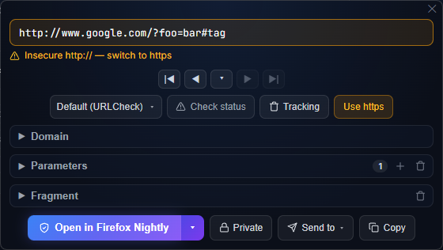
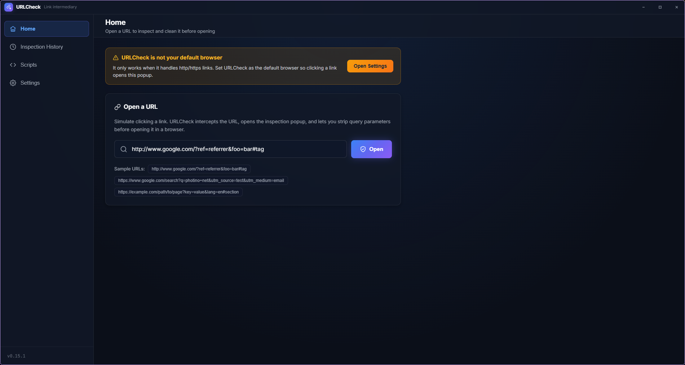

<div align="center">
  
  <h1>URLCheck</h1>
  <p><strong>Check the URL before it opens in your browser.</strong></p>
</div>

URLCheck registers itself as a link handler, so clicking an `http`/`https` link opens a small
inspection popup instead of going straight to a browser. You get to see where the link really
goes, strip the tracking junk, and only then hand it to the browser you actually want.

<div align="center">
  <a href="docs/popup.png"></a>
  <br>
  <em>The inspection popup</em>
  <br><br>
  <a href="docs/main-window.png"></a>
  <br>
  <em>The main window</em>
</div>

## Why

Links can be dangerous if you do not check the URL first. This software makes that check happen
before the browser does anything.

It also fills a gap: [URLCheck](https://github.com/TrianguloY/URLCheck) covers Android, and has no
desktop version.

## Features

- **Intercept links** — installed as the default handler for `http`/`https`, so every clicked
  link passes through the popup. Stays resident in the tray.
- **Inspect before opening** — a borderless popup that fits its own content, on top of the
  other windows, showing the URL broken into scheme, host, parameters, and fragment.
- **Clean the URL** — edit or remove any query parameter, clear the fragment, drop the whole
  parameter list, or strip well-known tracking parameters in one click.
- **Check before trusting** — ask for the HTTP status of the URL (following redirects), or step
  through redirects one hop at a time to see where a shortener leads.
- **Open where you want** — pick a browser per link, optionally in a private/incognito window.
  The most-used browser becomes the default button.
- **History** — every intercepted URL is recorded locally in SQLite and can be searched, and
  clicking an entry reopens the popup for it.
- **Float a button over copied links** — copying an `http(s)` URL anywhere makes a small button
  appear next to the pointer; one click opens the inspection popup without switching applications.
  It can be turned off in the settings.

## Built with

- **C# on .NET 10** — all of the logic: intercepting links, the tray, parsing and cleaning the URL,
  launching the browser, and the history.
- **React 19 + TypeScript**, bundled by **Vite** and styled with **styled-components** — the
  interface. It is presentation only: it exchanges JSON messages with the C# side and does no work
  of its own.
- **Photino.NET** — the desktop shell. It shows the interface in the operating system's own web
  view, which is why the web view is a runtime dependency: WebView2 on Windows, WebKitGTK on Linux.

## Running

The published builds are **self-contained** — they bundle the .NET runtime, so nothing needs to be
installed for them. What the operating system still has to provide:

### Windows

1. The Microsoft Edge **WebView2 Runtime**. If you are not using Windows 11, you need it.
  [Microsoft's page](https://developer.microsoft.com/microsoft-edge/webview2/).
2. Any Windows version lower than 11 is not officially supported.
   If you have any issues, You need to fix by yourself.
3. A tiling window manager has to be told to leave the floating button alone: its web view needs the
   window to be briefly visible to start up, so a window manager that tiles it leaves it the wrong
   size and in the wrong place. For GlazeWM, this ignores both it and the popup:

```yaml
window_rules:
  - commands: ['ignore']
    match:
      - window_process: { equals: 'URLCheck' }
      - window_title: { regex: '^(Popup|SelectionButton)$' }
```

### Linux

1. The web view for GTK.
2. An AppIndicator library, for the tray icon only.
3. `wl-clipboard` 2.3 or newer, for the floating button over copied links only. Wayland hides the
   clipboard from applications that are not focused, and `wl-paste --watch` is the way around it.
   Without it the button simply never appears there.
4. Only tested on **Fedora 44 with KDE Plasma on Wayland**. Every other distribution is untested, and the
  runtime libraries are the fiddly part, so start from the libraries rather than the package names.
5. Only support Wayland right now. If you are a super nerd running something like an old window manager on X11, you
   should fix any issues by yourself.

| Distribution    | Packages                                                          |
|-----------------|-------------------------------------------------------------------|
| Fedora 44       | `sudo dnf install webkit2gtk4.1 libayatana-appindicator-gtk3`     |
| Debian / Ubuntu | `sudo apt install libwebkit2gtk-4.1-0 libayatana-appindicator3-1` |
| anything else   | find whatever provides the libraries below                        |

```
libwebkit2gtk-4.1.so.0          libjavascriptcoregtk-4.1.so.0
libgtk-3.so.0                   libglib-2.0.so.0
libayatana-appindicator3.so.1   (or the older libappindicator3.so.1)
```

A missing web view library shows up as `Unable to load shared library 'Photino.Native'` at
startup. To find the package that owns a missing soname, ask your package manager — for example
`dnf provides 'libwebkit2gtk-4.1.so.0'`, `apt-file search libwebkit2gtk-4.1.so.0`, or
`pacman -F libwebkit2gtk-4.1.so.0`.

The AppIndicator library is only needed for the tray icon: without it the app still runs, it just
has no tray and keeps its main window visible instead.

## Building

- [.NET 10 SDK](https://dotnet.microsoft.com/download)
- [Node.js](https://nodejs.org/) 20 or newer, to build the interface

## Build and run

### Development

The interface is served by Vite, so run both:

```bash
# terminal 1 — the interface on http://127.0.0.1:3000
cd URLCheck/UserInterface
npm install
npm run dev

# terminal 2 — the desktop app
dotnet run --project URLCheck
```

Debug builds load the interface from the dev server. Useful arguments:

```bash
dotnet run --project URLCheck -- --tray        # start hidden in the tray
dotnet run --project URLCheck -- "https://example.com/?utm_source=x"   # open the popup for a URL
```

### Release

`npm run build` copies the interface into `URLCheck/Resources/wwwroot`, which the project embeds
into the executable — so build the interface before publishing.

```bash
cd URLCheck/UserInterface && npm run build
cd ../.. && ./URLCheck/publish.sh          # publish.bat on Windows
```

That produces a single self-contained executable per platform under
`URLCheck/bin/Release/net10.0/<rid>/publish/`.

## Where things are stored

|          | Windows                                  | Linux                                    |
|----------|------------------------------------------|------------------------------------------|
| Settings | `%APPDATA%\URLCheck\settings.json`       | `~/.config/URLCheck/settings.json`       |
| History  | `%APPDATA%\URLCheck\history.db`          | `~/.config/URLCheck/history.db`          |
| Logs     | `%APPDATA%\URLCheck\logs\urlcheck-*.log` | `~/.config/URLCheck/logs/urlcheck-*.log` |

Logs are written to the file and mirrored to the console, so a log file is enough to report a
problem. They roll daily and the last seven are kept.

## Notes on Linux

Tested on Fedora 44, KDE Plasma, Wayland. Wayland deliberately does not let an application place
its own windows, so a few things behave differently there than on Windows or X11:

- the popup cannot be forced to the center of the screen — the compositor positions it, usually
  relative to the main window;
- always-on-top is a no-op, because the GTK Wayland backend has no implementation for it.

Neither is a bug in URLCheck; both are limitations of the protocol.

You can make popup windows always-on-top and forced to the center of the screen in KWin if you are on KDE Plasma.
